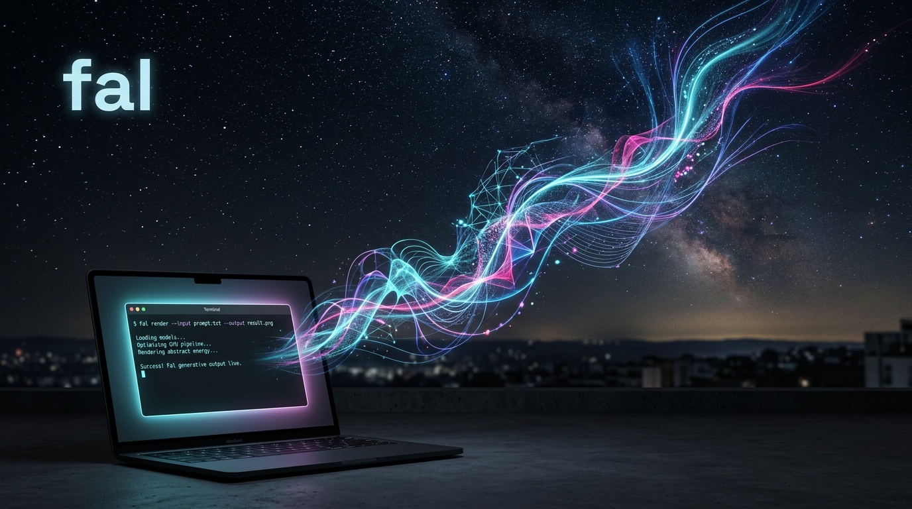

# fal CLI
> Deploy generative media apps to fal GPUs

[Teaser video](teaser.mp4)

## X thread
**1/5** Write a Python app. Run it on a GPU. Ship it with a persistent URL. All from your terminal. Meet the fal CLI.

**2/5** pip install fal
fal auth login
fal run app.py   # test it
fal deploy       # ship it

That's the loop.

**3/5** Deployed apps get persistent URLs, autoscale, and scale to zero when idle. Billed per second, so you're not paying for GPUs you're not using.

**4/5** Serverless access is approved per account. Request it, then build: https://fal.ai/dashboard/serverless-get-started

**5/5** Docs, quick start, and install steps: https://fal.ai/docs

Go ship something on a GPU today.

## LinkedIn
Most teams building generative media apps spend more time wrangling GPU infrastructure than writing the actual model code. The fal CLI closes that gap.

Write your Python app. Test it locally against a real GPU with `fal run`. Ship it with `fal deploy`. That's the loop.

What you get on deploy:
- A persistent URL for your app
- Automatic scaling, including scale to zero when idle
- Per-second billing, so idle time doesn't cost you

Install with pip install fal (Python 3.8+, works on macOS, Linux, and Windows). Log in with fal auth login or set FAL_KEY, and you're ready to run and deploy.

Serverless access is approved per account — request it here: https://fal.ai/dashboard/serverless-get-started

Full docs and quick start: https://fal.ai/docs

If you're building generative media models or apps, this is the fastest path from laptop to GPU in production.

---
Generated with launchkit · copy: anthropic/claude-sonnet-5 via openrouter/router · image: fal-ai/nano-banana-2 · video: fal-ai/kling-video/v3/standard/image-to-video